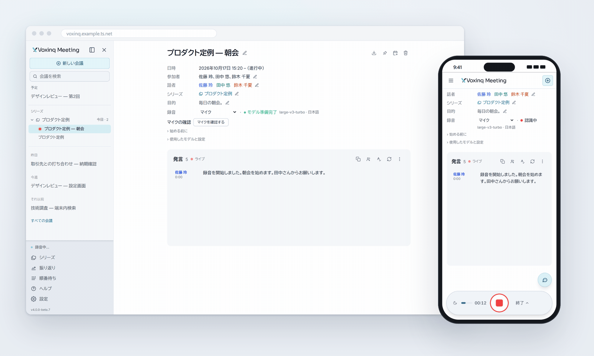
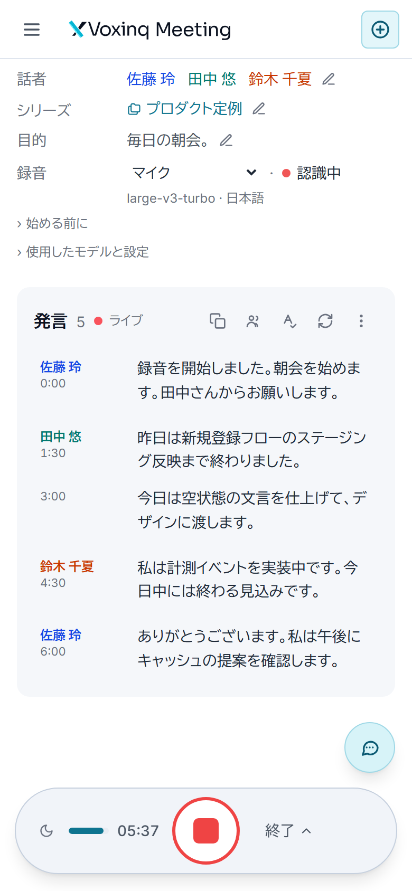
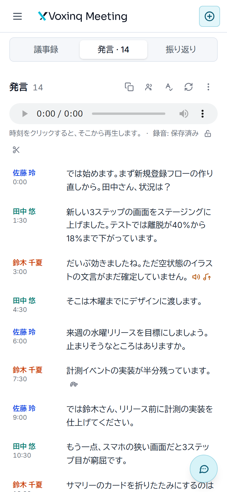
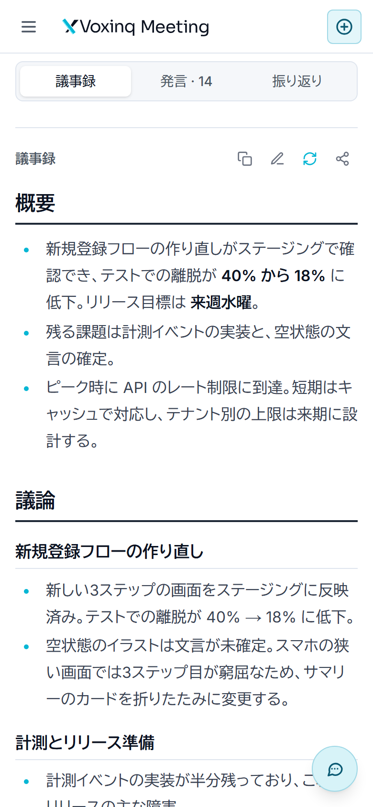

<div align="center">

# Voxinq Meeting

**手持ちのスマホで会議を録音し、自分の PC で文字起こし・話者分離・議事録作成まで行う会議記録アプリです。既定では、音声も議事録も外部のサービスに送りません。**

[**English README →**](README.md)

<picture>
  <source media="(prefers-color-scheme: dark)" srcset="docs/screenshots/ja/hero-dark.gif">
  
</picture>


[](https://github.com/ikasast/voxinq-meeting/releases/latest)


**[📦 セットアップ](#はじめ方)** · **[📱 Android アプリを入手](https://github.com/ikasast/voxinq-meeting/releases/latest)** · **[📖 詳しいドキュメント](#詳しいドキュメント)**

</div>

## できること

| 録音する | 発言を読む | 議事録を受け取る |
| --- | --- | --- |
|  |  |  |
| スマホで録音すると、話したそばから発言が出ます。PC のブラウザで同時に見ることもできます。 | 発言ごとに、誰がいつ話したかが付きます。聞き間違いを直す、そこから再生する、会議に質問する、ができます。 | 自分の PC の AI が、選んだ形式で議事録を書きます。Word や PDF に書き出せます。 |

## なぜ自分のマシンで動かすのか

- **専用の録音端末は要りません。** 録音はいつも持ち歩いているスマホで、文字起こしと議事録は手元の
  コンピュータで完結します。買い足す機器も、端末ごとの契約もありません。
- **音声も文字起こしも議事録も、手元から出ません。** 文字起こしや議事録を外部のサービスに頼むかは
  その都度自分で選び、送り先は画面に表示されます。
- **何人で使っても、サブスクのような固定費がかかりません。**
- **モデルを自分で選べます。** 文字起こし（Whisper）と議事録の AI を、手元の性能や会議の内容に合わせて
  選び、いつでも入れ替えられます。手元でも、別のマシンでも構いません。
- **データを丸ごと持ち出せます。** すべてのデータを 1 つのファイルに書き出し、別のマシンに戻せます。
  どこかのサービスに縛られません。

## セキュリティの考え方

守る場所を 4 つに分けて考えています。

- **入口：インターネットに公開しない。** スマホと PC は Tailscale の中だけでつながり、既定では
  外からアプリに届く道がありません。
- **出口：外へ送らない。** 既定では何も外部に送りません。さらに、準備が済んだらインターネットへ一切
  出られない専用サーバーにもできます（→ [閉じたサーバーで動かす](docs/ja/closed-network.md)）。
- **中身：人ごとに暗号化する。** アカウントを作ると、発言と議事録は本人の鍵で暗号化され、管理者にも
  読めません。
- **端末：なくしたスマホから開かせない。** Android アプリは指紋・顔・画面ロックでロックでき、管理者は
  全員のスマホに必須にできます。Tailscale 側の二段階認証と端末の承認もあわせて勧めています。

詳しくは [セキュリティと外部公開](docs/ja/security.md) を見てください。

## はじめ方

NVIDIA GPU 搭載の Windows PC を例にしています。**推奨構成**は、その PC ＋ Android スマホ ＋ Tailscale です。

**① 入れる**：PC に [Docker Desktop](https://www.docker.com/products/docker-desktop/) と
[Tailscale](https://tailscale.com/download)、スマホに Tailscale を入れ、**同じアカウント**でログインします。

**② Tailscale で HTTPS を使えるようにする**：[管理コンソールの DNS](https://login.tailscale.com/admin/dns) で
**MagicDNS** と **HTTPS Certificates** を有効にします。PC のアドレスは `<ホスト名>.<テイルネット名>.ts.net`
という形です（[機器一覧](https://login.tailscale.com/admin/machines)でコピーできます）。

**③ ファイルを 2 つ取得し、`.env` に 4 項目を書く**

```bash
mkdir voxinq
cd voxinq
curl -O https://raw.githubusercontent.com/ikasast/voxinq-meeting/release/docker-compose.yml
curl -o .env https://raw.githubusercontent.com/ikasast/voxinq-meeting/release/.env.example
```

```env
POSTGRES_PASSWORD="自分で決めるパスワード"
DATABASE_URL="postgresql://voxinq:上と同じパスワード@db:5432/voxinq"
TZ="Asia/Tokyo"
STT_WS_URL="wss://<ホスト名>.<テイルネット名>.ts.net:8443/ws"
```

`STT_WS_URL` は、スマホから文字起こしサービスに届くアドレスで、スマホで録音するなら必須です。
ほかの項目は、使いたくなったときに足せば十分です（[`.env` の全項目](docs/ja/setup.md#env-に何を書くか)）。

**④ 起動し、議事録用の AI モデルを入れ、スマホから届くようにする**

```bash
docker compose up -d
docker compose exec ollama ollama pull qwen3:8b
tailscale serve --bg --https=443 localhost:3000
tailscale serve --bg --https=8443 localhost:8000
```

> ⚠️ 8443（文字起こしサービス）には認証がありません。**Tailscale の外（Funnel など）には
> 絶対に公開しないでください。**

**⑤ スマホで `https://<ホスト名>.<テイルネット名>.ts.net` を開く**：Android はアプリ（下記）で、
iPhone は Safari で開きます。最初の本番の前に、[短い会議を 1 本通しで試してください](docs/ja/setup.md#動作確認)。

<details>
<summary><b>NVIDIA GPU が無い PC や Mac の場合</b></summary>

GPU の無い PC でも Mac でも動きます。違いは、文字が会議中ではなく**会議の終了後にまとめて出る**ことと、
議事録の作成に時間がかかることです。起動時に CPU 用の設定も読み込みます。

```bash
curl -O https://raw.githubusercontent.com/ikasast/voxinq-meeting/release/docker-compose.cpu.yml
docker compose -f docker-compose.yml -f docker-compose.cpu.yml up -d
```

→ [GPU の種類による違い](docs/ja/setup.md#gpu-の種類による違い)
</details>

<details>
<summary><b>ほかの入れ方</b>（<code>voxinq</code> コマンド、Homebrew、Scoop、ソースから）</summary>

すべての入れ方と、常駐のさせ方は [詳しい導入手順](docs/ja/setup.md) にあります。
</details>

<details>
<summary><b>Android アプリの入れ方</b></summary>

1. スマホで **[最新のリリース](https://github.com/ikasast/voxinq-meeting/releases/latest)** を開き、
   **Assets** の `voxinq-<版>.apk` をタップします。
2. ダウンロードしたファイルを開きます。ブラウザからのインストールを許可するか聞かれたら許可し、**インストール** をタップします。
3. Voxinq を開き、`https://<ホスト名>.<テイルネット名>.ts.net` を入力します。

画面を消しても録音が続き、サーバーにつながらないときもスマホに録音を残し、予定の会議の時刻に通知します。
指紋・顔・画面ロックでアプリをロックすることもできます（最初に一度だけ勧めます）。
サーバーのほうが新しくなると、上部に **更新** が出ます。詳しくは [アプリの README](android/README.md)。
</details>

## 拡張機能

録音・文字起こし・議事録が中心で、ほかは管理者が **設定 → 拡張機能** で入れ切りします。

- **話者分離** — 誰の発言かを分けます。一度声を登録すると、以降の会議で名前が付きます
- **シリーズ** — 定例会議の背景とメンバーを共有し、前回の議事録を踏まえて次を書きます
- **予定とリマインド** — 先の会議を入れておき、時刻になったら知らせます
- **振り返り** — ファシリテーターや参加者を、決めた基準で 100 点満点で評価します
- **会議に質問** — 会議の議事録や発言、シリーズ全体に質問できます
- **まとめて議事録** — 議事録の無い会議を、一度にまとめて順番待ちに入れます
- **議事録の形式** — 自分の形式や書き方の指示を使えます
- **訂正の提案** — 用語集・シリーズ・参加者と照らして、発言の直しを提案します
- **翻訳** — 外国語の発言の下に日本語訳を出します
- **声の調子** — いつもより大きい・高い・速い声の発言に印を付けます
- **感情** — 発言が喜び・怒り・悲しみのどれに聞こえたかを判定します
- **読み取り専用の共有** — Tailscale の外から見られる、パスワード付きのリンクを作ります
- **外部の AI** — 議事録や文字起こしを、選んだ外部サービスに頼めます

拡張機能でなくても、アカウントごとの暗号化、Markdown・Word・PDF への書き出し、全データのバックアップ、
日本語・英語の画面はいつでも使えます。

## 詳しいドキュメント

| ドキュメント | 内容 |
| --- | --- |
| [詳しい導入手順](docs/ja/setup.md) | 環境別の入れ方、`.env` の全項目、GPU の種類による違い、`HF_TOKEN`、動作確認、更新のしかた |
| [機能の説明](docs/ja/guide.md) | 録音から議事録までの流れ、各機能、設定画面、Android アプリ |
| [セキュリティと外部公開](docs/ja/security.md) | 何が外に出るか、アカウントと暗号化、復旧コード、Tailscale の外からの閲覧 |
| [閉じたサーバーで動かす](docs/ja/closed-network.md) | インターネットに出られない専用サーバー、準備と更新、入口の固め方 |
| [困ったとき・FAQ](docs/ja/troubleshooting.md) | 症状別の対処とよくある質問 |
| [仕組み](docs/architecture.md)（英語） | 構成と設計の判断 |

## ライセンス

[MIT ライセンス](LICENSE) — © 2026 ikasast。使っている AI モデルには、それぞれ別のライセンスが
あります（pyannote のモデルは Hugging Face での規約同意が必要です）。個別の表示は
[NOTICE.md](NOTICE.md) に、イメージに含まれる全パッケージとそのライセンスは各リリースの添付ファイルにあります。
