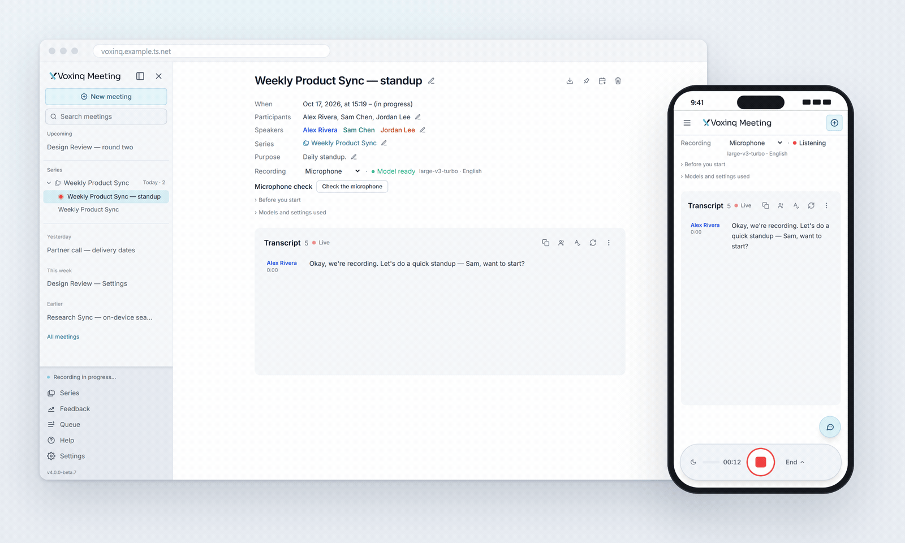
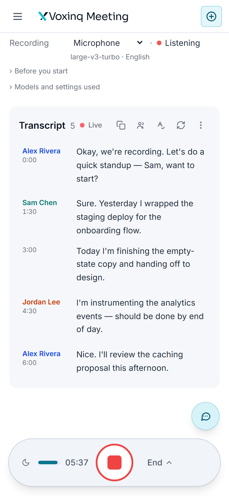
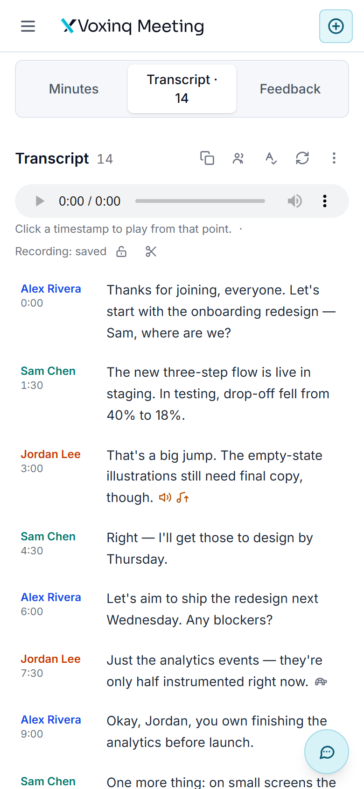
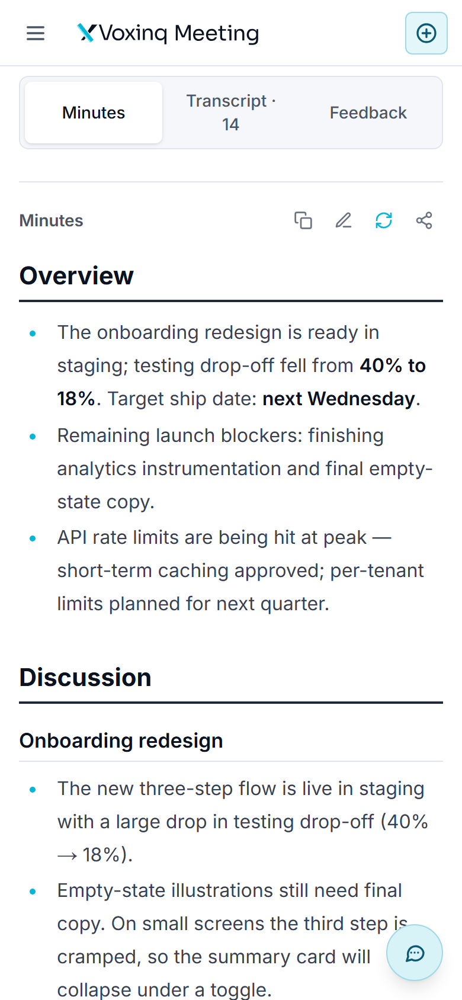

<div align="center">

# Voxinq Meeting

**Record meetings on the phone you already carry. Transcribe them, tell the speakers apart and write the minutes on your own PC. By default nothing leaves it.**

[**日本語ガイド →**](README.ja.md)

<picture>
  <source media="(prefers-color-scheme: dark)" srcset="docs/screenshots/hero-dark.gif">
  
</picture>


[](https://github.com/ikasast/voxinq-meeting/releases/latest)


**[📦 Set it up](#quick-start)** · **[📱 Get the Android app](https://github.com/ikasast/voxinq-meeting/releases/latest)** · **[📖 Documentation](docs/README.md)**

</div>

## What it does

| Record | Read the transcript | Get the minutes |
| --- | --- | --- |
|  |  |  |
| The phone records; the lines appear as they are spoken, on the phone and on any browser watching. | Each line with who said it and when. Fix a line, play from it, or ask the meeting a question. | Minutes written by a model on your PC, in a format you choose, ready to export. |

## Why on your own machine

- **No recorder to buy.** The phone you carry records, and a computer you already have does the
  transcribing and the minutes. No extra device, and no contract per device.
- **The audio, the transcripts and the minutes stay with you.** Sending recognition or minutes to an
  outside service is your choice, per run, and the destination is named on screen.
- **No fixed cost, however many people use it** — nothing like a per-person subscription.
- **Your choice of models.** Pick the Whisper model and the LLM that suit your hardware and your
  meetings, local or remote, and swap them at any time.
- **All of it is yours to take.** The whole instance exports to one file and imports on another
  machine; nothing ties you to a service.

## How it is kept safe

Four places, each closed on its own:

- **The way in: nothing on the internet.** The phone and the PC meet inside Tailscale. By default
  there is no route to the app from outside it.
- **The way out: nothing sent.** By default nothing goes to an outside service, and once it is set
  up the server can be one that cannot reach the internet at all
  ([A closed server](docs/closed-network.md)).
- **What is kept: encrypted per person.** With accounts, each person's transcripts and minutes are
  encrypted under their own key — not readable by an administrator either.
- **The devices: a lost phone does not open.** The Android app locks behind the phone's fingerprint,
  face or screen lock, and an administrator can require that of every phone. Two-factor sign-in
  and device approval on the Tailscale side are recommended alongside.

More in [encryption](docs/usage.md#encryption), [remote access](docs/remote-access.md) and
[hardening what is allowed in](docs/closed-network.md#hardening-what-is-allowed-in).

## Quick start

For a Windows PC with an NVIDIA GPU. **Recommended:** that PC, an Android phone, and Tailscale.

**① Install** [Docker Desktop](https://www.docker.com/products/docker-desktop/) and
[Tailscale](https://tailscale.com/download) on the PC, and Tailscale on the phone — signed in with the
same account on both.

**② Turn on HTTPS in Tailscale.** In the admin console's [DNS page](https://login.tailscale.com/admin/dns),
enable **MagicDNS** and **HTTPS Certificates**. The PC's address has the form `<host>.<tailnet>.ts.net`
([machines list](https://login.tailscale.com/admin/machines)).

**③ Fetch the two files, and set four values in `.env`**

```bash
mkdir voxinq
cd voxinq
curl -O https://raw.githubusercontent.com/ikasast/voxinq-meeting/release/docker-compose.yml
curl -o .env https://raw.githubusercontent.com/ikasast/voxinq-meeting/release/.env.example
```

```env
POSTGRES_PASSWORD="a password you choose"
DATABASE_URL="postgresql://voxinq:the-same-password@db:5432/voxinq"
TZ="Europe/London"
STT_WS_URL="wss://<host>.<tailnet>.ts.net:8443/ws"
```

`STT_WS_URL` is where the phone reaches the transcription service, and recording from a phone needs it.
The rest of `.env` can wait until you want it ([every variable](docs/configuration.md)).

**④ Start it, fetch the minutes model, and make it reachable from the phone**

```bash
docker compose up -d
docker compose exec ollama ollama pull qwen3:8b
tailscale serve --bg --https=443 localhost:3000
tailscale serve --bg --https=8443 localhost:8000
```

> ⚠️ Port 8443, the transcription service, has no authentication. **Never publish it outside your
> tailnet** (Funnel or otherwise).

**⑤ Open `https://<host>.<tailnet>.ts.net` on the phone** — in the Android app (below), or in Safari on
an iPhone. Then [run one short meeting through](docs/setup.md#check-that-it-works) before the first real one.

<details>
<summary><b>Without an NVIDIA GPU, or on a Mac</b></summary>

It runs on any PC or a Mac. What changes is **when** the text appears — when the meeting ends instead
of as you speak — and that the minutes take longer. Start with the CPU override as well:

```bash
curl -O https://raw.githubusercontent.com/ikasast/voxinq-meeting/release/docker-compose.cpu.yml
docker compose -f docker-compose.yml -f docker-compose.cpu.yml up -d
```

See [what runs on what](docs/setup.md#what-runs-on-what).
</details>

<details>
<summary><b>Other ways to install</b> — the <code>voxinq</code> command, Homebrew, Scoop, from source</summary>

All of them, and the background services that keep it running, are in [Setup](docs/setup.md).
</details>

<details>
<summary><b>The Android app</b></summary>

1. On the phone, open **[the latest release](https://github.com/ikasast/voxinq-meeting/releases/latest)**
   and tap `voxinq-<version>.apk` under **Assets**.
2. Open the download; if Android asks, allow your browser to install apps, then tap **Install**.
3. Open Voxinq and enter `https://<host>.<tailnet>.ts.net`.

It records with the screen off, keeps recording when the server cannot be reached, rings at a booked
meeting's time, and offers **Update** at the top when your server is newer. It can also lock behind
the phone's fingerprint, face or screen lock — offered once, the first time. More in
[the app's README](android/README.md).
</details>

## Extensions

Recording, transcription and minutes are the core. The rest are extensions an administrator switches
on under **Settings → Extensions**:

- **Speaker separation** — who said each line; enrol a voice once and it is named in every meeting after
- **Series** — recurring meetings share a background and members, and the last minutes carry into the next
- **Schedule and reminders** — book meetings ahead, and be told when one is due
- **Meeting feedback** — a score out of 100 for the facilitator or a participant, against criteria you set
- **Ask about meetings** — ask a meeting's minutes or transcript, or a whole series, a question
- **Write minutes in bulk** — queue minutes for every meeting that has none, in one go
- **Minutes formats** — your own formats and writing instructions
- **Suggest corrections** — check the transcript against your glossary, the series and the participants
- **Translation** — a Japanese translation under each line spoken in another language
- **Voice cues** — mark the lines said louder, higher or faster than the speaker usually was
- **Emotion** — whether each line sounded joyful, angry or sad
- **Read-only sharing** — a password-protected link outside your tailnet
- **External AI** — minutes or recognition by a service of your choosing

Always there: accounts with per-person encryption, export to Markdown, Word or PDF, backup of the
whole instance, and an interface in English or Japanese.

## Documentation

| I want to… | Read |
| --- | --- |
| Install it, every route | 📦 [Setup](docs/setup.md) |
| Use it day to day | 📖 [Usage & recipes](docs/usage.md) |
| Reach it from a phone, or share read-only | 🌐 [Remote access](docs/remote-access.md) |
| Change a setting | ⚙️ [Configuration](docs/configuration.md) |
| Use a different LLM | 🤖 [LLM providers](docs/llm-providers.md) |
| Use the Android app | 📱 [Android app](android/README.md) |
| Understand how it works, and why | 🏗 [Architecture](docs/architecture.md) · 🧭 [Design decisions](docs/design-decisions.md) |
| Fix a problem | 🩺 [Troubleshooting](docs/troubleshooting.md) |

Similar open-source projects: [Meetily](https://github.com/Zackriya-Solutions/meeting-minutes),
[Transcription Stream](https://github.com/transcriptionstream/transcriptionstream).

## License

Released under the [MIT License](LICENSE) — © 2026 ikasast. Third-party components ship under their
own licenses: [pyannote.audio](https://github.com/pyannote/pyannote-audio) models require accepting
their terms on Hugging Face (used only on an NVIDIA GPU), and Whisper and your chosen LLM are subject
to theirs. [NOTICE.md](NOTICE.md) covers what needs a word of its own, and each release lists every
package in its images with its licence.
